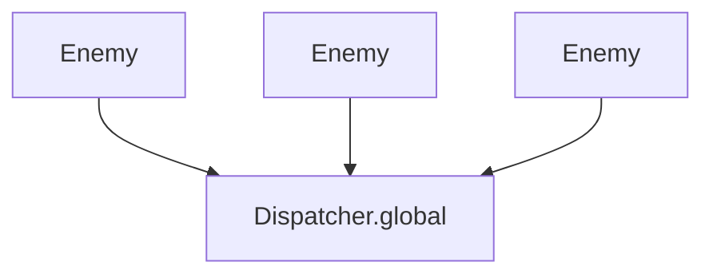
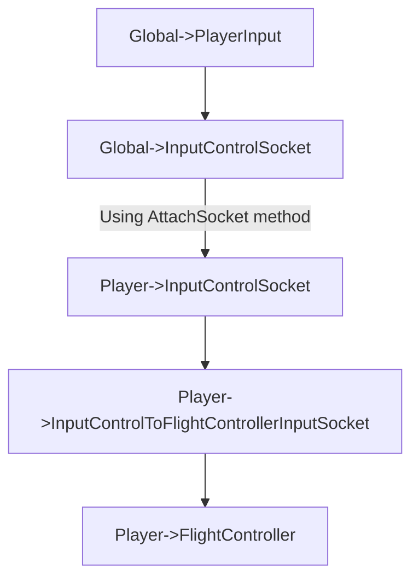

Announce Pattern
==

Announce Pattern is based on global Dispatcher. It is used to register a game object or specific component instance in the signleton Dispatcher.

For example, if you'd wish to have a collection of all enemy units in the game, you can create a component that will announce itself in the Dispatcher when it is created, and remove itself from the Dispatcher when it is destroyed.

```csharp
public class Enemy : MonoBehaviour
{
    private void OnEnable()
    {
        Dispatcher.global.Announce(this);
    }

    private void OnDisable()
    {
        Dispatcher.global.Conceal(this);
    }
}
```

Then you can get all enemy units in the game by using `Dispatcher.global.SubscribeAnnounced<Enemy>(Action<T[]> handler)` method.



Use cases
--

### Display count of enemies in the game

```csharp
class GameController : MonoBehaviour
{
    private void Start()
    {
        Dispatcher.global.SubscribeAnnounced<Enemy>(OnEnemyCreated);
        Dispatcher.global.SubscribeConcealed<Enemy>(OnEnemyDestroyed);
    }

    private void OnEnemyCreated(Enemy[] enemies)
    {
        Debug.Log($"Enemy created. Total count: {enemies.Length}");
    }
    
    private void OnEnemyDestroyed(Enemy enemy)
    {
        Debug.Log($"Enemy destroyed. Total count: {enemies.Length}");
    }
}
```

### Connect input control socket to the flight controller

The socket system allows you to create socket adapters. Socket adapters are used to convert input from one socket to another. For example, you can create a socket adapter that converts input from the keyboard to the input socket of the flight controller.



To connect input control socket to the input control socket to the flight controller input socket, you can use announce pattern. You should create a separate singleton object for the input control socket and player input component. Then you can connect the local input control socket to the singleton input control socket by using `AttachSocket` method of the `Socket` class.

You can create PlayerController component that will announce itself in the Dispatcher when it is created, and remove itself from the Dispatcher when it is destroyed.

```csharp
public class PlayerController : MonoBehaviour
{
    private void OnEnable()
    {
        Dispatcher.global.Announce(this);
    }

    private void OnDisable()
    {
        Dispatcher.global.Conceal(this);
    }
}
```

Then you can get all player controllers in the game by using `Dispatcher.global.SubscribeAnnounced<PlayerController>(Action<T[]> handler)` method and attach input control socket to the flight controller input socket.

```csharp
class GameController : MonoBehaviour
{
    [SerializeField] private InputControlSocket inputControlSocket;
    private void Start()
    {
        Dispatcher.global.SubscribeAnnounced<PlayerController>(OnPlayerControllerCreated);
        Dispatcher.global.SubscribeConcealed<PlayerController>(OnPlayerControllerDestroyed);
    }

    private void OnPlayerControllerCreated(PlayerController[] playerControllers)
    {
        foreach (var playerController in playerControllers)
        {
            var playerInputControlSocket = playerController.GetComponent<InputControlSocket>();
            // Attach input control socket to the flight controller input socket
            playerInputControlSocket.AttachSocket(inputControlSocket);
        }
    }
    
    private void OnPlayerControllerDestroyed(PlayerController playerController)
    {
        var playerInputControlSocket = playerController.GetComponent<InputControlSocket>();
        // Detach input control socket from the flight controller input socket
        playerInputControlSocket.DetachSocket(inputControlSocket);
    }
}
```