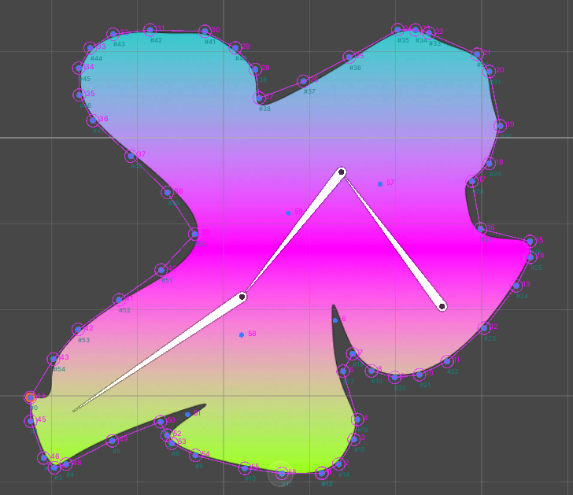
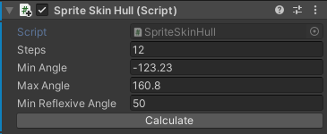

Поиск оболочки
==

Trigf.FindJarvisGreedyHull
--

- Assembly: _studio.metamatic.kernel.runtime_

Метод позволяет осуществить поиск индексов массива точек в двухмерном пространстве, образующих собой оболочку



```c#
var points = spriteSkit.GetDeformedVertexPositionData().ToArray();
var indexes = Trigf.FindJarvisGreedyHull(points.Select(v3 => v3.ToVector2()).ToArray(), steps, minAngle, maxAngle, minReflexiveAngle);
```

Поскольку без анализа самого изображения набор точек не может дать однозначно правильного результата, функция предоставляет несколько параметров для тонкой настройки алгоритма:

- **steps** - количество итераций алгоритма (0 - поиск выпуклой оболочки)
- **minAngle** - минимальный угол при поиске следующей точки
- **axAngle** - максимальный угол при поиске следующей точки
- **i0ReflexiveAngle**- минимальный возвратный угол (если поисковая точки погружается вглубь формы, то угол возврата к конечной точке не может быть меньше данного значения)

Значения по умолчанию для этих параметров являются наиболее подходящими для общих случаев.

> Если есть возможность создавать вершины самостоятельно (например через редактор Skinning editor), то в местах исзгибов или если вершины противоположных стороны лежат слишком близко к друг другу, повысить плотность вершин.

### Принцип работы алгоритма

В первую очередь алгоритм находит выпуклую оболочку (convex hull) по алгоритму Джарвиса. Если интераций более 0, то далее применяет модифицированный алгоритм Джарвиса, но уже между найденными точками. Последовательно перебираются каждое ребро выпуклой оболочки и между первой и последней точкой ребка ищется новая точка, ближайшая к краю: вначале в направлении от первой точки с последней, затем от последней к первой, с ограничением максимального расстояния равного расстоянию между первой и последней точкой. К найденным точкам применяется опциональная проверка минимального возвратного угла.

Работа алгоритма считается завершенной если достигнут предел циклов или более не находятся точки, удовлетворяющие условиям.

### Производительность

На текущем этапе разработке производительность алгоритма пока не оценивалась, однако навскидку можно сказать что количество перебора всех точек равно количеству точек * количество шагов, что дотаточно тяжело. **Не рекомендуется выполнять алгоритм каждый фрейм**.

### To do

- В данный момент циклы (staps) необходимо для того, что бы указать сколько раз алгоритм должен проводить поиск точки для каждого ребра. Однако есть идея полностью убрать steps и выполнять поиск точек для ребра бесконечно до момента ненахождения новых. В таком случае между итеграций, просто каждое ребро должно уходить в бесконечный цикл поиска точек. Это может быть более экономно, поскольку лишний раз не будет прогоняться поиск по всем точкам для ребер, для которых новых точек уже нет.

Поиск вершин SpriteSkin
--

```c#
var points = spriteSkit.GetDeformedVertexPositionData().ToArray();
var indexes = Trigf.FindJarvisGreedyHull(points.Select(v3 => v3.ToVector2()).ToArray(), steps, minAngle, maxAngle, minReflexiveAngle);
```

### Вспомогательный компонент SpriteSkinHull

- **Component**: _SpriteSkinHull_
- **Assembly**: _studio.metamatic.nature2d.runtime_

Компонент _SpriteSkinHull_ осуществляет поиск вершин изображения, содержащегося в SpriteSkin, с поддержкой координат деформации.



```c#
var points = spriteSkinHull.hullPoints; // массив точек оболочки (не кешируется)
```

Поиск вершит спрайта
--

Для получения всех вершин спрайта можно обратиться к свойству _vertices_.

```c#
var allPoints = sprite.vertices.ToArray();
var hullPointIndexes = Trigf.FindJarvisGreedyHull(allPoints);
```

Зачем может понадобиться поиск оболочки
--

Поиск оболочки - редкий и требовательный к производительности кейс. Он может понадобиться когда необходимо обрисовать контур графики, так же он может быть нужен когда необходимо проверить, лежит ли точки внутри изображения.

