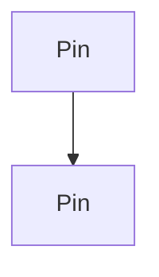
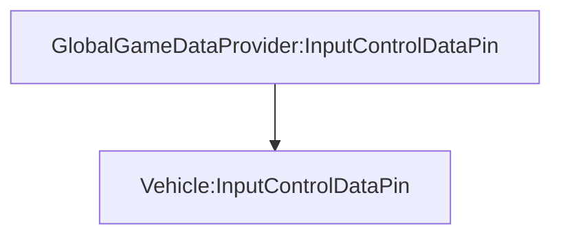
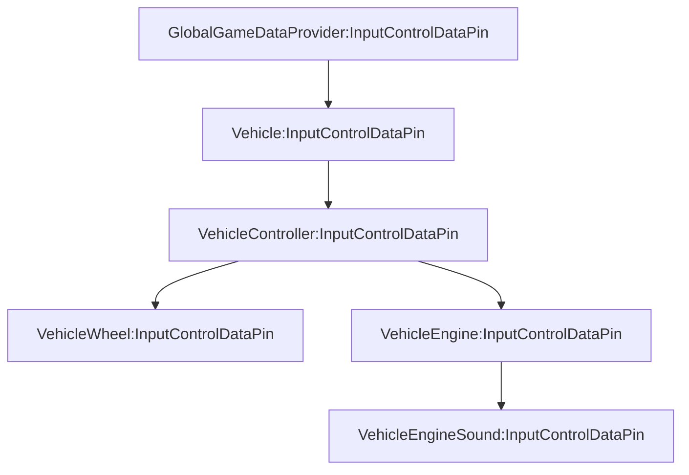


# Pin

## Theory

Pin is a MonoBehaviour component that can be connected to another pin of the same generic type.



Each pin has a strict data type. It supports a specific type of data, enabling compatibility with any data type.

The primary purpose of the pin is to facilitate data transfer from one component to another, adhering to a string data type contract. For example, you might want to supply input control data to various components that require it. Pin offers an efficient solution. You create one pin of type `InputControlDataPin` and attach it to the source object where the data originates, and another identical pin to the target object where the data is sent. By connecting these two pins, data is seamlessly transferred from the source to the target.



Pins can be interconnected to create a data flow chain.



Pin is designed as a high-performance data flow mechanism, ensuring that no data is duplicated during transfer. Each receiver accepts data as efficiently as if receiving it directly from the source.

## Getting Started

Suppose you need to connect an input control data source with a vehicle controller. First, create a data type struct.

```csharp
public struct InputControlData
{
    public float Acceleration;
    public float Steering;
    public float Brake;
}
```

Next, create a pin with the same data type.

```csharp
public class InputControlDataPin : Pin<InputControlData>
{
}
```

Then, create a source object to provide the data.

```csharp
public class GlobalGameDataProvider : MonoBehaviour
{
    public InputControlDataPin InputControlDataPin;
    
    private void Update()
    {
        InputControlDataPin.SetData(new InputControlData
        {
            Acceleration = Input.GetAxis("Vertical"),
            Steering = Input.GetAxis("Horizontal"),
            Brake = Input.GetAxis("Jump")
        });
    }
}
```

Create a target object to receive the data.

```csharp
public class Vehicle : MonoBehaviour
{
    public InputControlDataPin InputControlDataPin;
    
    void Update()
    {
        var inputControlData = InputControlDataPin.GetData();
        // ...
}
```

Add the `InputControlDataPin` component to both objects, attaching it to the `InputControlDataPin` and `Vehicle` fields.

Finally, connect these two pins. A flexible approach is to handle connections through a global script responsible for all connections.

```csharp
public class GameLogicConnections : MonoBehaviour
{
    public GlobalGameDataProvider GlobalGameDataProvider;
    public Vehicle Vehicle;

    private void Start()
    {
        GlobalGameDataProvider.InputControlDataPin.Connect(Vehicle.InputControlDataPin);
    }
}
```

A primary advantage of this approach is the ability to connect and disconnect pins as needed. For instance, to shift vehicle control to AI, simply connect the vehicle's input control data pin to the AI's input control data pin instead fo gamepad input control. To switch a player to a walking model, disconnect the vehicle input control data pin from the player and connect it to the walking model pin.

Data observer
--

Pin supports data observation. You can subscribe to data changes and receive notifications when data is updated.

```csharp
public class Vehicle : MonoBehaviour
{
    public InputControlDataPin InputControlDataPin;
    
    private void Start()
    {
        InputControlDataPin.SubscribeData(OnInputControlDataChanged);
    }

    private void OnInputControlDataChanged(InputControlData data)
    {
        // ...
    }
}
```

Avoid of using data observation if the data is updated frequently. In this case, use the `GetData()` method instead or `GetDataRef()` if you need a reference to the data (for structs).

```csharp
public class Vehicle : MonoBehaviour
{
    public InputControlDataPin InputControlDataPin;
    
    void Update()
    {
        ref var inputControlData = ref InputControlDataPin.GetDataRef();
        // ...
    }
}
```

Maximum performance pattern
--

Pin supports maximum performance. If you expect that the data will be updated very frequently, use `Mutate` method instead of `SetData`. `Mutate` allows you to modify pin data without recreating data object. And specify second parameter `true` (silent) - to update data without invoking change event. In this case you can obtain data in receiver in Update method.

```csharp
public class GlobalGameDataProvider : MonoBehaviour
{
    public InputControlDataPin InputControlDataPin;
    
    private void Update()
    {
        InputControlDataPin.Mutate((ref InputControlData data) => {
            data.Acceleration = Input.GetAxis("Vertical");
            data.Steering = Input.GetAxis("Horizontal");
            data.Brake = Input.GetAxis("Jump");    
        }, true);
    }
}
```

---

For more advantages and pin auto-connections, use Pin within [Slot and Modules](/SlotsAndModules).
