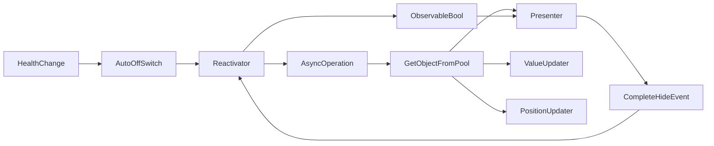

Smooth appearance strategy
==

Theory
--

This approach assumes that any object can be obtained from the pool, and then smoothly shown and then smoothly hidden. At the same time, the approach supports obtaining an object and smoothly shown on demand.

For example, when a character health is changed, the health bar is shown and then smoothly hidden. When the character health is changed again, the health bar is shown again and then smoothly hidden. Let's look at this situation, as it is simple only at first glance.

When health change event is triggered, we need to do the following:

1. Show for a certain time health bar. It means that we need some mechanism to show the health bar for a certain time and then hide it.
2. Decide what happening if the health bar is shown and the health change event is triggered again. Should we hide the health bar and show it again? Or should we extend the time of showing the health bar? The last way seems right to me. Therefor we need some mechanism to extend the time of showing the health bar.
3. If the mechanisms described above still decided that the health bar should be visible, where will we get the object with the health bar from? Suppose we need to show a health bar above the character, we shouldn't keep health bar within the character object. We need to get the health bar object from the pool. Therefor we need some mechanism to get the health bar object from the pool and when the health bar is not needed, return it back to the pool.
4. After the health bar is retrieved from the pool, we need to show it smoothly. Therefor we need some mechanism to show the health bar smoothly and then hide it smoothly.
5. When the mechanism described in the first point decides that the health bar should be hidden and, accordingly, it should be send to the pool, but hide animation is still in progress, we need to wait until the hide animation is finished. Therefor we need some mechanism to wait until the hide animation is finished, before sending the health bar to the pool.
5.1. What if new health change event is triggered when the health bar is in the process of hiding? Should we show the health bar again? Or should we wait until the hide animation is finished and then show the health bar again? Or should we interrupt the hide animation and show the health bar again? The last way seems right to me. Therefor we need some mechanism to interrupt the hide animation and show the health bar again.
6. At least, when we retrieve the health bar from the pool, we need to do two things while the health bar is shown:
    - update the health bar with the new health value. Therefor we need some mechanism to update the health bar with the new health value.
    - update the position of the health bar. Therefor we need some mechanism to update the position of the health bar.

Thus, a large number of maintenance mechanisms are formed here:

- Mechanism to show the health bar for a certain time and then hide it.
- Mechanism to extend the time of showing the health bar.
- Mechanism to get the health bar object from the pool and when the health bar is not needed, return it back to the pool.
- Mechanism to show the health bar smoothly and then hide it smoothly (and this mechanism should be able to observe the state of hiding the health bar to keep the object out of pool until it is totally hidden).
- Mechanism to wait until the hide animation is finished, before sending the health bar to the pool.
- Mechanism to update the health bar with the new health value.
- Mechanism to update the position of the health bar.

This leads to the creation of several abstractions.:

- Abstraction that allows to turn on some observable boolean flag that will be turned off after a certain time automatically. This abstraction should be able to extend the time of turning on the flag.
- Abstraction that starts an async operation when the boolean flag is turned for the first time and wait for the operation to be finished. If the flag is turned off or then turned on again, the operation should not be started again until the previous operation is finished. 
- Abstraction that allows to get the object from the pool and return it back to the pool.
- Abstraction that allows to show the object smoothly and hide it smoothly. This abstraction should be able to observe the state of hiding the object to keep the object out of pool until it is totally hidden.
- Abstraction that allows to update the object with the new value.
- Abstraction that allows to update the object position.

There's scenario:



Implementation
--

There are few classes that solve the problem:

- **AutoOffSwitch** - this class allows to turn on some observable boolean flag that will be turned off after a certain time automatically. This abstraction should be able to extend the time of turning on the flag.
- **Reactivator** - this class starts an async operation when the boolean flag is turned for the first time and wait for the operation to be finished. If the flag is turned off or then turned on again, the operation should not be started again until the previous operation is finished. Also this class pass `Observable<bool>` to the async operation arguments, so the async operation can track the state of the flag to dynamically show or hide the object without restarting the operation.
- **Summoner** - this class allows to get the object from the pool and return it back to the pool. Actually, it can work not only with a pool. The way to get an object depends on the implementation of the abstraction.
- **Presenter** - this class allows to show the object smoothly and hide it smoothly. This abstraction should be able to observe the state of hiding the object to keep the object out of pool until it is totally hidden. It takes `Observable<bool>` as an argument, so it can track the state of the object to dynamically show or hide the object without restarting the operation.
- **ValueUpdater** - can be implemented with simple frame-based updater (e.g. `UniTask.WaitUntil` or better yet, `PlayerLoop.EachFrameUntil`).
- **PositionUpdater** - can be implemented with simple frame-based updater, but in a case of showing the health bar in the correct position, it should take into account not only position of the character, but position and anchor of the place where the health bar should be shown. Thus, the logic of PositionUpdater should be more complex than the logic of ValueUpdater.

Here's the example of the implementation:

```csharp
/* For example, Run is async entry point of logic*/
protected override async UniTask Run(Ready ready, Signal signal)
{
    /* First, instantiate Summoner. This instance will persist for the duration of the character's existnce in the scene */
    m_Summoner = new InstantiateMonoBehaviourSummoner<VerticalTileIndicator2D>(verticalTileIndicator2D);
    /* Create reactivator */
    using var reactivator = Reactivator.Create(SummonObject, true);
    /* Create autoOffSwitch */
    using var autoOffSwitch = m_AutoOffSwitch = AutoOffSwitch.Create(0.65f, reactivator.Enable, reactivator.Disable, () => {});
    /* Wait for the signal to dispose all the resources */
    await signal;
}

/* This method is called when the reactivator decids that health bar should be shown */
private async UniTask SummonObject(Observable<bool> enabledObserver, Signal cancellationSignal)
{
    using var summon = m_Summoner.Summon(); // Summon the object (in this case, simple instantiate it)
    var instance = summon.instance; // Get health bar instance
    instance.transform.position = spawnCoords; // Set start position
    m_Presenter = instance.GetOrAddComponent<FadeByMaterialAlphaPresenter>(); // Get or add Presenter component (I specivifically use the component so that the next time I use it, it will already be there)
    m_Presenter.Reset(); // Reset presenter
    using var observeEnabled = enabledObserver.Watch(m_Presenter.Set); // Start watching the enabledObserver and set the presenter state accordingly
    using var observeFillAmount = m_IndicatorFillAmount.Watch(fillAmount =>
    {
        instance.fillAmount = fillAmount; // Update the health bar fill amount
    });
    await m_Presenter.WaitForDismissal(); // Wait for the presenter to be dismissed (in this case, it completes the hide animation)
    // If we are here, the presenter is dismissed and we can return the object to the pool
    // The object will be returned to the pool automatically, because the summoner is disposed
    // The presenter stays with the game object, so we can reuse it next time
    // The observeEnabled and observeFillAmount are disposed automatically
    // After the await, the reactivator will decide whether to show the health bar again or not
    Console.Log("Indicator", "End summoning");
}
```

What you need to know and remember
--

- The approach is quite complex and requires a lot of maintenance. It is suitable for complex cases where the object should be shown and hidden smoothly.
- Using `AutoOffSwitch` and `Reactivator` is a good way to start async operation when the object should be shown and wait for the operation to be finished. Also, it is a good way to extend the time of showing the object.
- Using `Summoner` is a good way to get the object from the pool and return it back to the pool.
- Using `Presenter` is a good way to show the object smoothly and hide it smoothly. It is a good way to observe the state of hiding the object to keep the object out of pool until it is totally hidden.

Polymorphism
--

### Presenter

The approach can be implemented with polymorphism. For example, you can your own implementation of the `Presenter` class that will show the object in a different way. To do that, you need to create a new class that inherits from the `Presenter` class and override the `Show` and `Hide` methods.

```csharp
public class MyPresenter : Presenter
{
    protected override async UniTaskVoid OnPresent(Signal cancellationSignal) {
        // Your implementation
        // For example, you can show the object with the scale animation
        // or with some other animation
    }

    protected override async UniTask OnDismiss(Signal cancellationSignal)
    {
        // Your implementation
    }
    
    protected override void OnReset()
    {
        // Your implementation
    }
}
```

### Summoner

The approach can be implemented with polymorphism. For example, you can your own implementation of the `Summoner` class that will get the object from the pool in a different way.

```csharp
public class InstantiateMonoBehaviourSummoner<T> : Summoner<T> where T : MonoBehaviour
{
    private T m_Prefab;
    public InstantiateMonoBehaviourSummoner(T prefab) : base()
    {
        m_Prefab = prefab;
    }
    protected override T OnSummon()
    {
        // Your implementation
    }

    protected override void OnBanish(T instance)
    {
        // Your implementation
    }
}
```

Placement provider
--

When you construct a health indicator next to a character, you realize that it's not enough to have a character's position to display the indicator. Placing an indicator with a simple offset about the character's starting position is not always universal. Some characters are taller, others are shorter. You need to be able to handle multiple indicators on one character at once (for example, a health indicator and a mana indicator).

All this leads to an understanding of the need for more precise control over the location of the indicator and the prepared spaces for the indicators. This is where the placement provider comes in.

In a context of placement indicator above the character there is an important thing as optional placement. The optional placement is a situation when the place for the indicator is occupied by another indicator. In this case, the placement provider should be able to provide a new place for the indicator or dismiss the request for placement.

```csharp
public interface IPositioning: IUniTaskAsyncDisposable
{
  public (Vector3 position, Vector2 anchor) GetPositionAndAnchor();
}

public interface IPlacementProvider
{
  public delegate UniTask PlacementRequestHandler(IPositioning positioningSupply, Signal cancellationSignal);
  public IAsyncDisposableAbortable RequestPlacement(PlacementRequestHandler handler, Observable<bool> observableEnabled);
}
```

The `IPlacementProvider` interface allows you to request a placement of an object in some area. The `PlacementRequestHandler` delegate is a method that will be called when the placement is requested. The `IPositioning` interface provides information for the object that needs to be placed. The `Signal` class allows you to cancel the placement request immediately.

For example, you need to show a health indicator above the character. You can create a `HealthIndicatorPositioning` class that implements the `IPositioning` interface and provides the position and anchor for the health indicator. But what if the place for the health indicator is occupied by another indicator? You can use the `IPlacementProvider` interface to request a placement of the health indicator. Placement providers check the availability of the place for the health indicator and if the place is available, provided async handler is called.

```csharp
void OptionalShowHealthIndicator(Observable<bool> oEnabled, Signal cancellationSignal) {
    using var placementRequest = character.auraUi.RequestPlacement(AuraUiPlacement.Left | AuraUiPlacement.Right, Handler, oEnabled);
    await placementRequest.WhenComplete(cancellationSignal);
}
```

Let's figure out how this can work together with the Smooth appearance approach.

```csharp
/* For example, Run is async entry point of logic*/
protected override async UniTask Run(Ready ready, Signal signal)
{
    /* First, instantiate Summoner. This instance will persist for the duration of the character's existnce in the scene */
    m_Summoner = new InstantiateMonoBehaviourSummoner<VerticalTileIndicator2D>(verticalTileIndicator2D);
    /* Create reactivator */
    using var reactivator = Reactivator.Create(RequestPlacement, true);
    /* Create autoOffSwitch */
    using var autoOffSwitch = m_AutoOffSwitch = AutoOffSwitch.Create(0.65f, reactivator.Enable, reactivator.Disable, () => {});
    /* Wait for the signal to dispose all the resources */
    await signal;
}

/*
* This method is called when the reactivator decids that health bar should be shown
* As an activator handler it should complete it work when two conditions are met:
* - oEnabled is false
* - SummonObject is completed
* And there's a cancellationSignal that can be used to cancel the placement request without waiting for the completion of the SummonObject
*/
private async UniTask RequestPlacement(Observable<bool> oEnabled, Signal cancellationSignal)
{
    await using var placementRequest = character.auraUi.RequestPlacement(SummonObject, oEnabled);
    await placementRequest.WhenComplete(cancellationSignal);
}
```

Thus, as Reactivator handler placementRequest must follow the same rules as the SummonObject method. It should asynchronously complete its work when oEnabled is false. If he didn't, reactivator would not be able to decide whether to show the health bar again or not.

Let's name this rule as a **reactivation rule**.

### Reactivation rule

**Reactivator decides when to trigger the async operation, but the async operation decides when to complete its work**.

It is possible because of `Observable<bool>` that is passed to the async operation. The async operation can track the state of the flag to dynamically show or hide the object without restarting the operation. When oEnabled is false and the async operation has completed the transition to this state, the async operation should complete its work.

The same approach is used in placement requests. The placement request should complete its work when oEnabled is false and the async operation has completed the transition to this state. But since a placement request may not immediately provide the placement, for placement request there is one more additional condition for completing its work:

- If a placement request has not managed to call the handler function by the time oEnabled switches to false, it completes its work immediately.

### Placement provider implementation example

```csharp
public class AuraUi : IPlacementProvider
{
    public IAsyncDisposableAbortable RequestPlacement(AuraUiPlacement placement, PlacementRequestHandler handler, Observable<bool> oEnabled)
    {
        
    }
}
```